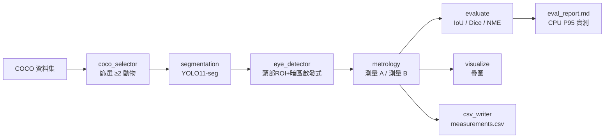

# 動物眼睛量測 Pipeline（Image Segmentation + Metrology）

將影像分割（Image Segmentation）模型的輸出，應用於實際測量學（Metrology）任務：
從 COCO 資料集挑出含兩隻（含）以上動物的圖片，分割動物輪廓、定位動物眼睛，並量測
（A）每隻動物的雙眼距離、（B）任意兩隻動物的右眼距離。

## 專案介紹

- **輸入**：COCO 資料集中含 ≥2 隻動物的圖片（動物類別任選）。
- **處理**：YOLO11-seg 分割動物輪廓 → 以頭部 ROI + 幾何/暗區啟發式定位左右眼（SAM2 精修為可選）。
- **輸出**：
  - 疊圖（`outputs/annotated/*.png`）：mask、左右眼（左藍右紅）、量測連線與距離數值。
  - 量測 CSV（`outputs/measurements.csv`）：測量 A 與測量 B 共用固定欄位 schema。
  - 評估報告（`outputs/eval_report.md`）：IoU / Dice / NME 與 CPU 單張 P95 效能實測。

### 成果摘要

- 測量 A：同一隻動物左眼↔右眼的歐氏距離。
- 測量 B：兩隻動物右眼↔右眼的歐氏距離（恰 2 隻→1 筆；恰 ≥3 隻→所有兩兩配對 C(n,2)）。
- 無法可靠定位眼睛者標記「無法量測」並記錄原因，不輸出臆測值；相同輸入與設定產生相同結果。

## 題目回應（逐項說明）

以下對照題目六項要求，逐一說明本專案如何達成。

### 1. 選用的圖片

- 本次展示選用的圖片為 COCO val2017 的 **`000000555705.jpg`**（兩隻貓，正面特寫）。
- 檔案位置：`data/samples/000000555705.jpg`（已含於 repo 供檢視）。
- 來源：以 `src/coco_selector.py` 從 COCO val2017 篩出含 **≥2 隻動物** 的圖片（動物類別任選，涵蓋 bird/cat/dog/horse/sheep/cow/elephant/bear/zebra/giraffe；val2017 共 471 張合格，清單見 `outputs/selected_images.json`），再從中挑此張作為展示。

### 2. 用 Segmentation 模型將動物輪廓 / 動物眼睛個別框出

- **動物輪廓**：YOLO11-seg 實例分割，輸出每隻動物的 instance mask、bbox、類別與信心分數（`src/segmentation.py`）。
- **動物眼睛**：COCO **沒有**動物眼睛標註，故以兩層策略定位（`src/eye_detector.py`）：
  - 貓：OpenCV Haar `frontalcatface` 偵測貓臉 → 臉框上半部左右對稱暗點定位雙眼。
  - 其他動物：頭部 ROI + 幾何/暗區啟發式。
  - 所有眼睛座標標記為估計值（`is_estimated=True`）；無法可靠定位則標記「無法量測」。
- 疊圖同時畫出 mask、左右眼（左藍右紅）與量測連線（`outputs/annotated/*.png`）。

### 3. 量測每隻動物的雙眼距離（測量 A）

- 公式（左眼↔右眼歐氏距離，`src/metrology.py::eye_distance`）：

$$D = \sqrt{(x_L - x_R)^2 + (y_L - y_R)^2}$$

- 左右眼任一無法定位 → 標記 `measurable=False` 並記錄原因，不輸出臆測值。
- 實測（展示圖 `000000555705.jpg`）：橘貓 **45.0 px**、虎斑貓 **34.0 px**。

### 4. 量測任意兩隻動物的右眼距離（測量 B）

- 公式（兩動物右眼歐氏距離，`src/metrology.py::inter_animal_right_eye`）：

$$D = \lVert R_a - R_b \rVert_2$$

- 配對規則：恰 2 隻動物 → 1 筆；恰 ≥3 隻已定位右眼 → 所有兩兩配對 C(n,2) 筆。
- 僅 1 隻動物有右眼 → 標記「不適用（需至少兩隻右眼）」而非報錯。
- 實測（展示圖）：兩貓右眼距離 **108.3 px**。

### 5. 使用什麼 AI 模型、為什麼、評估標準公式

- **動物輪廓分割：Ultralytics YOLO11-seg（COCO 預訓練）**
  - 為什麼：COCO 80 類預訓練直接涵蓋常見動物，一次推論即取得類別 / bbox / instance mask / 信心分數；CPU 可推論、部署容易，符合離線與效能需求。
- **貓眼睛定位：OpenCV Haar `frontalcatface`（傳統 CV）+ 臉內暗點對稱定位**
  - 為什麼：COCO 無動物眼睛標註，且無單一現成模型可通用於全部動物；對正面貓臉，Haar 臉偵測能把眼睛搜尋範圍縮到臉內，比直接在整個 bbox 猜測準確許多。非貓動物回退幾何啟發式並誠實標記為估計值。
- **評估標準公式**：
  - 分割品質：

$$\text{IoU} = \frac{|A \cap B|}{|A \cup B|} \qquad \text{Dice} = \frac{2|A \cap B|}{|A| + |B|}$$

  - 眼睛定位（以眼間距或頭框尺寸正規化）：

$$\text{NME} = \frac{1}{N}\sum_{i=1}^{N}\frac{\lVert p_i - \hat{p}_i \rVert_2}{d_{norm}}$$

  - 評估實作見 `src/evaluate.py`（`iou` / `dice` / `nme`）。

### 6. 量測方式與公式，以及如何驗證

- **量測方式**：於像素座標（原點左上、x 向右、y 向下）計算歐氏距離；左右眼以影像視角的 x 位置區分（x 小者為左眼）。預設單位為像素，提供比例尺時可換算實際單位。
- **驗證方式**（四層）：
  1. **疊圖人工目視**：`outputs/annotated/*.png` 檢查左右眼標記、連線與數值是否合理。
  2. **ground truth 對照**：對 ≥10 張人工標註眼睛，計算 NME / 像素誤差（`--eval`）。
  3. **一致性檢查**：左右眼對稱性、雙眼距與頭框尺寸比例合理性。
  4. **單元測試**：`pytest` 對距離公式與評估公式的已知座標驗證數學正確性（39 測試通過，metrology/evaluate 覆蓋率 ≥ 80%）。
- **效能與決定性**：單張 CPU P95 ≤ 5s（實測記錄於 `outputs/eval_report.md`）；固定種子與 pinned 版本，相同輸入產生相同結果。

> 展示結果：輸入 `data/samples/000000555705.jpg`、疊圖 `outputs/annotated/000000555705.png`、量測 `outputs/measurements.csv`、報告 `outputs/eval_report.md`。

## 技術棧

| 項目 | 技術 |
|------|------|
| 語言 | Python 3.11 |
| 實例分割 | Ultralytics YOLO11-seg（COCO 預訓練） |
| 眼睛定位 | 貓：OpenCV Haar frontalcatface 臉偵測 + 臉內暗點對稱定位；其他動物：頭部 ROI + 幾何/暗區啟發式；SAM2 精修（可選） |
| COCO 讀取/篩選 | pycocotools |
| 影像/數值 | opencv-python、numpy |
| 視覺化 | matplotlib |
| 資料模型 | pydantic |
| 測試 | pytest、pytest-cov |

### 為什麼用 YOLO11-seg

COCO 80 類預訓練直接涵蓋常見動物類別，一次推論即取得類別、bbox、instance mask 與信心分數，
CPU 可推論、部署容易，符合離線與效能需求。COCO 沒有動物眼睛標註，故眼睛定位以啟發式為主並標記估計值。

### 評估公式

$$\text{IoU} = \frac{|A \cap B|}{|A \cup B|} \qquad \text{Dice} = \frac{2|A \cap B|}{|A| + |B|} \qquad \text{NME} = \frac{1}{N}\sum_{i=1}^{N}\frac{\lVert p_i - \hat{p}_i \rVert_2}{d_{norm}}$$

（NME 以眼間距或頭框尺寸正規化。）

### 量測公式與驗證

測量 A（雙眼距離）：

$$D = \sqrt{(x_L - x_R)^2 + (y_L - y_R)^2}$$

測量 B（兩動物右眼距離）：

$$D = \lVert R_a - R_b \rVert_2$$

驗證：疊圖人工目視、≥10 張人工 ground truth 的 NME/像素誤差對照、左右眼對稱性檢查、pytest 單元測試。

## 本地運行步驟

```bash
# 1. 建立虛擬環境並安裝依賴
python -m venv .venv
# Windows: .venv\Scripts\activate   |  macOS/Linux: source .venv/bin/activate
pip install -r requirements.txt

# 2. 設定環境變數
cp .env.example .env   # 依需要調整 COCO 路徑、模型權重等

# 3. 準備資料：將 COCO 子集放到 data/coco/（影像 + annotations JSON）

# 4. 篩選含 ≥2 動物圖片（產出 outputs/selected_images.json）
python -m src.pipeline --coco-dir data/coco --min-animals 2

# 5. 對影像執行量測（產出疊圖 + measurements.csv）
python -m src.pipeline --input data/samples --output-dir outputs

# 6. 評估（產出 eval_report.md，含 CPU P95 實測）
python -m src.pipeline --input data/samples --eval

# 7. 執行測試
pytest tests -q
```

主要 CLI 旗標見 `specs/001-animal-eye-metrology/contracts/cli.md`。

## Docker 部署指令

```bash
docker compose build
# 執行 pipeline（將本地 data/、outputs/ 掛載進容器）
docker compose run --rm pipeline python -m src.pipeline --coco-dir data/coco --input data/samples
```

## API 文件

**不適用。** 本題為離線影像處理 pipeline，不提供線上推論 API 服務，故無 API 文件連結。
對外介面為 CLI，契約見 `specs/001-animal-eye-metrology/contracts/cli.md`。

## 測試帳號資訊

**不適用。** 本專案無登入機制或需認證的服務，故無測試帳號。

## 專案結構

```
src/            # config, models, segmentation, eye_detector, metrology, evaluate, visualize, csv_writer, pipeline
tests/          # unit（metrology/evaluate/eye_detector）, integration（pipeline/selection）
data/           # coco 子集、samples、ground_truth（內容由 .gitignore 忽略）
outputs/        # annotated 疊圖、measurements.csv、eval_report.md
docs/           # architecture.md 系統架構圖（mermaid）
specs/          # spec-kit 規格文件（spec/plan/research/data-model/contracts/tasks）
```

## 系統架構圖

資料流：COCO → 篩選 → 分割 → 眼睛定位 → 測量 A/B → 評估 → 視覺化 + CSV。完整版見 `docs/architecture.md`。


