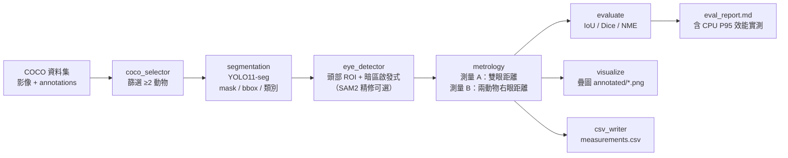

# 系統架構圖（動物眼睛量測 Pipeline）

資料流：COCO → 篩選 → 分割 → 眼睛定位 → 測量 A/B → 評估 → 視覺化 + CSV。

## 資料流程圖

## 模組對應

| 階段 | 模組 | 輸出 |
|------|------|------|
| 篩選 | `src/coco_selector.py` | `outputs/selected_images.json` |
| 分割 | `src/segmentation.py` | 每隻動物 mask / bbox / 類別 / 信心 |
| 眼睛定位 | `src/eye_detector.py` | 左右眼 `EyePoint`（估計值標記） |
| 測量 | `src/metrology.py` | 測量 A / 測量 B `MeasurementRecord` |
| 評估 | `src/evaluate.py` | IoU / Dice / NME |
| 視覺化 | `src/visualize.py` | `outputs/annotated/*.png` |
| 輸出 | `src/csv_writer.py` | `outputs/measurements.csv` |
| 串接 | `src/pipeline.py` | CLI 進入點、`outputs/eval_report.md` |

## 關鍵設計

- **眼睛定位誠實性**：COCO 無動物眼睛標註，以啟發式為主並標記 `is_estimated`；無法可靠定位時標記「無法量測」，不輸出臆測值。
- **決定性**：固定隨機種子與 pinned 版本，相同輸入與設定產生相同結果。
- **容錯**：單張圖片失敗以隔離方式記錄並續跑，不中斷整批。
